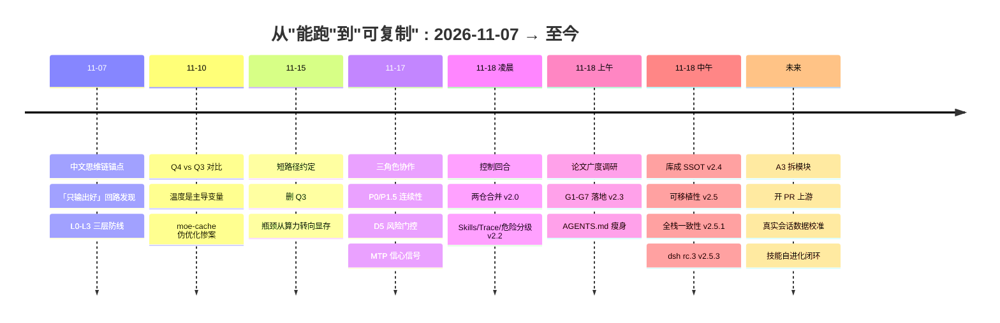

# dsh-agent-harness

> **DeepSeek Harness（dsh）的 agent harness 聚合插件** —— 在一个 8GB 显存的笔记本上，用确定性代码和结构化角色，帮 35B 本地模型把长会话任务稳定做完。
>
> 本仓库是 **Single Source of Truth**：插件代码 + 全部生产配置 + 10 个技能 + 19 个核心工具 + 决策档案 + 一键安装脚本。
> 当前版本 **v2.8.0**（2026-11-18）。仓库名沿用历史名 `dsh-behavior-guard`，npm 包名/插件 id 为 `dsh-agent-harness`。

---

# 第一部分 · 总览（The Big Picture）

## 1.1 我们在干什么（一句话）

> # 🧠 合成心智
>
> **用一个 35B 小模型 + 一套确定性脚手架，合成一个比模型本身可靠得多的心智——模型权重一个字节没动，变的是它外面的脑区。**

这不是给模型"调配置"，而是**合成**：模型提供原始推理能力，harness 提供它没有的器官——抑制控制（前额叶）、工作记忆与索引（海马体）、执行纪律、验证与免疫系统。三者组合后，涌现出一个单独模型不具备的、能稳定跑完长任务的行为体。

**为什么是"合成"而不是"仿生"或"配置"**：
- 不是仿生——我们不模拟人脑的生物学，只是按**功能缺陷补器官**：模型缺什么（抑制/记忆/执行/验证），就在 harness 层补什么。
- 不是配置——权重零改动，所有能力来自**外置的确定性代码和结构化角色**，是可拆、可测、可移植的工程组件。
- 是合成——模型 + 外置器官的组合，产生了任何单一组件都不具备的可靠性（同一模型换 scaffold **+15.6pp**（[2604.11465](https://arxiv.org/abs/2604.11465)）/ **+26pp**（9B）；[Thinking Before Thinking (2609.38147)](https://arxiv.org/abs/2609.38147) +13.5pp）。

### 演化链：从调参到合成心智

这段历史不是一开始就叫"脑"，是逐步长出来的（详见 [brain_map 与脑的物理整合](https://github.com/D-al/dsh-behavior-guard/blob/main/docs/BRAIN_AUDIT_20261118.md)）：

| 阶段 | 时间 | 我们在做什么 | 心智元素 |
|---|---|---|---|
| **肌肉** | 10-13～11-06 | 硬件/引擎调优：CUDA、量化、线程、KV cache、投机解码 | 只有算力，无脑 |
| **反射** | 11-07～11-11 | 「只输出好」回路、L0-L3、温度定量、decode 指标证伪 | 第一道**免疫反应** |
| **器官** | 11-15～11-17 | 海马体（task-state）、前额叶（task-plan）、三角色、CritBank、控制回合 | 外置**脑区**成形 |
| **整合** | 11-17 晚 | `D:/Brain` 独立域、脑的地图、一键快照——把脑从 WorkBuddy 解耦 | 脑有了**物理载体** |
| ** synthesis** | 11-18 | 库成 SSOT、一键开箱、可移植性、自进化、rc.3 升级免疫 | 脑可**复制、可进化** |

### 我们的原创方法论（11-17 确立）

> **守卫是免疫细胞（兜底未知病变）；脑区是外置器官（确定性补偿已知缺陷）。**
>
> 层次不同，共存正确。奥卡姆剃刀剔除的不是"没用的"，而是"被新器官替代的"——
> 判据是**功能重叠且实测无增益**。这条标准让我们删掉了模板目标锚定（-0.7% 噪声内）和
> languageReminder（被生成位置锚点覆盖），而不是一刀切砍守卫。

**现场实证（2026-11-18 13:39）**：一次真实 dsh 会话在长任务后段退化——16 次压缩注入同一份旧任务存档（"写插件"），
但当前任务已演化成"演示窗口"；模型陷入 `read×7 / write×5 / present×4` 的分布式重复循环，且
`read_image` 误读 `.html`。心智状态快照原型一眼检出三病：**任务漂移 + 分布式重复 + 26 事件信号空窗**。
这不是随机失误，是"没有会更新的状态层"的必然结果——见 [说明书 §7](docs/MANUALS.md#7-心智状态快照)。

**我们观察到**：本地小模型不是不会做，而是在长 agent 会话里**以可预测的方式退化**——重复失败、虚假完成、状态回卷、路径猜错、想完不干。这些不是模型能力问题，是 harness 问题。所以我们把论文和社区里的机制，逐条变成确定性代码或结构化角色，塞进 dsh 的 harness 层，再用端到端基准验证哪些真的有效。

## 1.2 三个贯穿全局的认知

| 认知 | 来源 | 对我们的意义 |
|---|---|---|
| **模型不是瓶颈，harness 是** | 社区 scaffold 实验 + [Three Roles (2604.11465)](https://arxiv.org/abs/2604.11465) | 优先改 harness，不换模型 |
| **decode t/s 是误导性指标** | 我们自己的 P5 惨案（[F1](#f1--moe-cache-cpu-share-伪优化)） | 任何"加速"必须端到端验证 |
| **模型不知道自己缺什么知识** | [Confident Fools (2610.41124)](https://arxiv.org/abs/2610.41124) | 用规则代替感觉（"不确定就搜"）|
| **合成 > 调教** | 我们自己的演化链（肌肉→反射→器官→整合→合成）| 模型权重不动，能力靠外置器官的组合涌现 |

## 1.3 宏观路线图（过去 → 现在 → 未来）



### 已完成（v2.5.3 为止）

| 阶段 | 时间 | 关键产出 |
|---|---|---|
| **筑基** | 11-07～11-11 | L0-L3 早收尾、温度定量（Q4@0.7 最优）、decode 指标证伪 |
| **外置** | 11-15～11-17 | 短路径、三角色、P0/P1.5 连续性、D5 风险门控、MTP 代理信号 |
| **治理** | 11-18 凌晨 | 控制回合（元推理）、两仓合并、Skills/Trace/危险分级 |
| **自进化** | 11-18 上午 | 7 项论文落地（技能草稿/反向修订/失败时间线/结构化验收/概率校准/双向验证/工具边界）|
| **工程化** | 11-18 中午 | 库成唯一真源、一键安装、AGENTS.md 瘦身 3959→2508 tok、可移植性、全栈一致性、dsh rc.3 升级 |

### 进行中 / 待做

| 状态 | 事项 | 前置条件 |
|---|---|---|
| 🟡 观察 | **用真实 dsh 会话积累数据**（`_audit_feedback.jsonl` / `crit_hit`）| 已开始——最新会话 trace 84 条，已捕获 1 次 LLM 审计 |
| ✅ 已接入 | **心智状态快照**（`mind_state.py` + 插件内置检测）——现场验证检出三病；触发式注入 + 强制二选一已上线 | 观察真实会话效果 |
| 🟡 待做 | **A3：拆 `index.mjs` 为 6 模块** | 等真实会话稳定后再动（高风险重构）|
| 🟡 待做 | **给上游开 autoparser PR**（两行空白修复）| 需写最小 repro + 测试 |
| 🟡 待做 | **G2/G5 校准出真实阈值**（MTP 0.65 / 无进展 6 是经验值）| 等反馈数据 ≥5 条 |
| ✅ 已完成 | **心智拼图 P0-P2**（验证循环/可控遗忘/写回审批/意图漂移/情景检索/BDI/事件流/会话树）——[操作手册](docs/MANUALS.md#8-心智拼图操作手册p0-p2) |
| 🟢 已完成 | **心智模型缺口广搜**（5 路并行 agent：认知科学/前沿/三缺口/社区/记忆）——[完整调研报告](docs/MIND_GAPS_RESEARCH.md) |
| 🔴 卡脖子 | **llama.cpp v1.0.0 升级**（FP8 KV 破显存墙）| 需重编 + 重打补丁 + 全量回归 |
| 🔴 卡脖子 | **dsh 暴露 logits / per-request 预算** | 上游支持，harness 侧无解 |

## 1.4 分支地图（每条都有自己的问题-措施-结果-新发现）

| 分支 | 一句话问题 | 状态 | 详见 |
|---|---|---|---|
| **A 行为治理** | 模型在失败后会重复、会虚报、会空手收尾 | ✅ 成熟 | [§2.A](#a--行为治理防退化) |
| **B 上下文/记忆** | 压缩后遗忘、长路径复述 0/5、计划说了不做 | ✅ 成熟 | [§2.B](#b--上下文--记忆防遗忘) |
| **C 角色/元认知** | 单 agent 自己审自己、只看眼前不看全局 | ✅ 成熟 | [§2.C](#c--角色--元认知防短视) |
| **D 质量/验证** | 做的人自己签字、产物有洞、配置漂移 | ✅ 成熟 | [§2.D](#d--质量--验证防虚报) |
| **E 能力边界** | 工具面膨胀、MCP 诱惑、模型不知自己边界 | ✅ 成熟 | [§2.E](#e--能力边界防膨胀) |
| **F 引擎/参数** | 8G 显存墙、温度/量化如何选、投机解码 | ✅ 稳定 | [§2.F](#f--引擎--参数榨干硬件) |
| **G 自进化** | 经验只进不出、错误教训自我强化 | 🟡 机制已装待数据 | [§2.G](#g--自进化从静态到会修订) |
| **H 工程化** | 配置散落、不可移植、升级破坏性变更 | ✅ 完成 | [§2.H](#h--工程化从能跑到可复制) |

> 用合成心智的语言说：A/B/C 是**脑区**（抑制/记忆/执行），D 是**免疫系统**（验证/自检），
> E 是**感官边界**（工具面），F 是**身体**（引擎/算力），G 是**可塑性**（自进化），H 是**可复制的载体**。
> A-F 是已完成的战场，G 是刚开垦的新战场，H 是工程底座。
> 失败与放弃的 10 条经验见 [§3 负面资产](#第三部分--负面资产别重试的清单)。
> 操作级细节（怎么装、怎么调、怎么查）见 **[说明书集合](docs/MANUALS.md)**。

## 1.5 🚀 一键开箱（新机器 / 重装后）

```powershell
git clone https://github.com/D-al/dsh-behavior-guard.git
cd dsh-behavior-guard
.\setup\install.ps1 -DryRun     # 先看会做什么（安全）
.\setup\install.ps1             # 实际恢复（不覆盖已存在文件）
.\setup\links.ps1 -DryRun       # 看 junction 映射计划
.\setup\links.ps1               # 建 7 个稳定 junction
.\setup\sync.ps1 -DryRun        # 日后改动回写时用
```

恢复内容：`config/`（AGENTS.md + env + router preset + template + critbank + rubrics + patch）+ `skills/`(10) + `tools/`(19) + `docs/` + 插件本体。详见 [说明书 §1](docs/MANUALS.md#1-一键开箱)。

**新机器仍需手工**：dsh/llama.cpp 本体 + 自编 b12244 二进制、计划任务（RestartDsh / FreezeWatch）、确认 bundles 含 `dsh-agent-harness`。

---

# 第二部分 · 分述（The Branches）

> 每统一格式：**问题 → 调研 → 措施 → 结果 → 新发现 → 依据（全带链接）**。

## A · 行为治理（防退化）

**问题**：同一现场 7 次异常 tool_result 后，模型连续回「好」然后 EOS（6/7 紧跟无信息结果）；`unknown tool` 后原样重试 7 次烧 10+ 步；想完不干（683 字计划后直接 EOS）。

**调研**：[Feedback That Backfires (2608.23651)](https://arxiv.org/abs/2608.23651) 实测失败记录使重复概率 **0.06→0.54**，且"删掉失败重试"反而最糟；[GUARD (ACL 2026)](https://arxiv.org/abs/2508.21433) 的认知螺旋理论——模型倾向顺着错误前提越走越远。

**措施**：L0 空手收尾 / L1 文件声明校验 / L2 贴代码检测 / L3 短确认词（模板 `is_stub` 渲染时跳过假完成 assistant，治本）；D1 重复探测 / D2 同参双败 / D3 冗余 todo（纯确定性，0 LLM）。

**结果**：现场回路消失；A/B 验证删历史「好」/屏蔽 token/`tool_choice=required` 全部 **0/2**——只有"渲染时跳过"治本。中文思维链唯一有效的是自述句锚点 `{{- '嗯，' }}`（祈使句会让模型回「好」后 EOS）。

**新发现**：**审计的误判风险 > 漏审风险**——纠正器猜错路径那次注入后模型进入重问循环，错误路径作为失败信息进上下文变成干扰源。

**依据**：[MAST (2503.13657)](https://arxiv.org/abs/2503.13657)（21.3% 多智能体失败是验证缺口）、[Feedback That Backfires](https://arxiv.org/abs/2608.23651)、[SAG (2609.05274)](https://arxiv.org/abs/2609.05274)。

## B · 上下文 / 记忆（防遗忘）

**问题**：13 字符路径复述 5/5、20 字符 1/5、73 字符完整路径 **0/5**；压缩后任务状态丢失；声明的计划只有 22~45% 被遵守。

**调研**：[Frontier LMs Struggle to Copy (2607.16072)](https://arxiv.org/abs/2607.16072)（1D RoPE 局部匹配偏置）、[In-context Superposition (2604.09670)](https://arxiv.org/abs/2604.09670)（记忆项纠缠编码）、[MemGPT (2310.08560)](https://arxiv.org/abs/2310.08560)、[Hippo (2610.24453)](https://arxiv.org/abs/2610.24453)（防污染：只存用户真实指令）、[Plan Declaration-Execution Gap (2609.38108)](https://arxiv.org/abs/2609.38108)。

**措施**：一律短相对路径（`p/ bench/ memory/`）；P0 压缩存档（任务合同/已验证决策/开放项/**已排除**/三问）；P1.5 todo 回灌；P1 闹钟；`CTX_CHECKPOINTS=2` 承重墙。

**结果**：路径问题根除；压缩后状态可恢复；"已排除"清单纳入存档——**被拒绝的方案是"最贵的信息"，叙事式摘要最先丢它**。

**新发现**：append-only 优于改写历史——改写思维链有 KV cache 后缀税（本机 20K 重预填充 **25~44s**），我们的注入天然规避。

**依据**：[MemGPT](https://arxiv.org/abs/2310.08560)、[Hippo](https://arxiv.org/abs/2610.24453)、[StateForge (2609.32520)](https://arxiv.org/abs/2609.32520)、U-Fold（浙大/阿里 2026）、ARC (ACL 2026)（无稳定 arXiv 编号，按会议/机构引用）、[The Complexity Trap (2508.21433)](https://arxiv.org/abs/2508.21433)。

## C · 角色 / 元认知（防短视）

**问题**：单 agent 自己审自己有作者偏差；只看下一步不看全局；模型不知道该先搜还是先做。

**调研**：[Three Roles One Model (2604.11465)](https://arxiv.org/abs/2604.11465)——同一 8B 权重三种 conditioning，AppWorld **5.4%→8.9%**，超过 33B；[Thinking Before Thinking (2609.38147)](https://arxiv.org/abs/2609.38147)（Meta 的 Controller 四动作）；[Tyler (2606.16360)](https://arxiv.org/abs/2606.16360)。

**措施**：执行者（唯一写权限）+ 审计员（只读+steer）+ 纠正器（只读代执行）+ Critic（只读产物）+ 验收员（三态）。每 8 步注入**控制回合**（已确立/当前项/已排除/列 2-3 候选）——零 LLM 的元推理。

**结果**：验收员生产级落地（10 步逐项核验后回注 PASS）；控制回合的方向被 Meta 论文印证。

**新发现**：**不能依赖模型的元认知**——[Confident Fools (2610.41124)](https://arxiv.org/abs/2610.41124) 实测小模型只搜 20% 该搜的；[MARTA (2610.05223)](https://arxiv.org/abs/2610.05223) 证明 Retrieve-Always = 诱导性失忆 → 用规则代替感觉。

**依据**：[Three Roles](https://arxiv.org/abs/2604.11465)、[Thinking Before Thinking](https://arxiv.org/abs/2609.38147)、[Tyler](https://arxiv.org/abs/2606.16360)、[MetaGPT (2308.00352)](https://arxiv.org/abs/2308.00352)。

## D · 质量 / 验证（防虚报）

**问题**：小模型虚假完成 ~13%，**自检只能从 12.7% 降到 11.8%**（同一盲区）；做的人自己签字。

**调研**：[MAST (2503.13657)](https://arxiv.org/abs/2503.13657)（1642 个多智能体失败，21.3% 验证缺口）、[Agent-as-a-Judge (2410.10934)](https://arxiv.org/abs/2410.10934)、Apple《Nine Judges, Two Effective Votes》(2026-06)（9 judge ≈ 2 票）、[JudgePanel (2608.29168)](https://arxiv.org/abs/2608.29168)。

**措施**：D4 交付闸门（"做的人不能自己签字"）；独立验收员三态；verify-on-edit（写后确定性语法检查，0 LLM）；present 深检；Critic 五维（含反向覆盖）；全栈 `config_check.py` 四层一致性。

**结果**：verify-on-edit 实测 **+15.6pp**（性价比最高的质量杠杆）；门禁 30/30；真实会话已捕获 1 次 LLM 审计。

**新发现**：**信号源多样性 >> judge 数量多样性**——否决多审计员，改用"MTP 信心 × 审计判定"双信号交叉（零成本）。

**依据**：[MAST](https://arxiv.org/abs/2503.13657)、[Agent-as-a-Judge](https://arxiv.org/abs/2410.10934)、[JudgePanel](https://arxiv.org/abs/2608.29168)、[SEVA (2606.29713)](https://arxiv.org/abs/2606.29713)、[AgentV-RL (2604.16004)](https://arxiv.org/abs/2604.16004)。

## E · 能力边界（防膨胀）

**问题**：工具面 28 个、单会话只用 11 个；工具一多准确率**崩塌不是缓降**（BFCL 4→51 工具 43%→2%）；MCP 的诱惑。

**调研**：[RAG-MCP (2505.03275)](https://arxiv.org/abs/2505.03275)（检索后 13.6%→43.1%）、[Cartograph (2609.30293)](https://arxiv.org/abs/2609.30293)（3 proxy tools 替 374 定义，475 vs 42,450 token）、[Cold-Start Tool Blindness](https://huggingface.co/datasets/thaki-AI/daily-paper-2026-08-03-deferred-tool-schema-discovery-cost)（反面：88.5% 工具在词汇不对齐时永不进 top5）。

**措施**：Skills 渐进披露（10 个技能卡，按关键词注入）；工具语义边界表（`tool-boundaries` skill）；**MCP 三重否决**；危险操作分级（block/warn）。

**结果**：AGENTS.md 从 3959→2508 tok（余量 1588）；10 个 skill 命中测试 4/4 场景全过。

**新发现**：**"按需加载"有反面**——deferred tool loading 省 98% token，但冷启动失明会让 88.5% 工具永远不被发现；所以保留静态工具面 + Skills，不做动态工具检索。

**依据**：[RAG-MCP](https://arxiv.org/abs/2505.03275)、[Cartograph](https://arxiv.org/abs/2609.30293)、[Cold-Start Tool Blindness](https://huggingface.co/datasets/thaki-AI/daily-paper-2026-08-03-deferred-tool-schema-discovery-cost)。

## F · 引擎 / 参数（榨干硬件）

**问题**：8GB 显存跑 21.28GiB 的 Q4 模型；温度/量化/投机解码参数如何选。

**调研与实测**：温度扫描 U 形曲线（0.1 想完不干、0.9 草率收工）；[MoE cache PR #29887](https://github.com/ggml-org/llama.cpp/pull/29887) 带来 1.5-2.2×；[SU (2609.05274)](https://arxiv.org/abs/2609.05274) 启发 MTP 信心信号。

**措施**：生产参数固化（[详见说明书 §2](docs/MANUALS.md#2-生产参数)）；自编引擎 b12244 + [autoparser 2 行补丁](config/patches/autoparser-fix.patch)；router 模式单模型驻留。

**结果**：20K decode 27.2 t/s / prefill 800 t/s；**Q4@0.7 是唯一在 P3/P4/P5 三项都 2/2 且最快的配置**。

**新发现**：**decode t/s 与端到端可以完全相反**（[F1](#f1--moe-cache-cpu-share-伪优化)）；FP8 KV + 非阻塞 MoE cache（v1.0.0）是破显存墙的方向，待升级验证。

**依据**：[SU](https://arxiv.org/abs/2609.05274)、[v1.0.0 release](https://github.com/ggml-org/llama.cpp/releases/tag/v1.0.0)、[#29307 token-aware parsing](https://github.com/ggml-org/llama.cpp/pull/29307)、[#29949 GPU-resident LRU](https://github.com/ggml-org/llama.cpp/issues/29949)。

## G · 自进化（从静态到会修订）

**问题**：技能是人工写的静态 md；错误教训写进 CritBank 后永久留着误导；门控阈值是经验值。

**调研**：[Trace2Skill (2603.25158)](https://arxiv.org/abs/2603.25158)、[SkillCAT (2606.13317)](https://arxiv.org/abs/2606.13317)、[ReHarness (2610.12668)](https://arxiv.org/abs/2610.12668)（forward-only 记忆的结构性缺陷）、[Failure as a Process](https://arxiv.org/abs/2602.02475)（决定性错误中位 step 7、step 16 才可见）。

**措施**：G1 技能草稿生成（`skill_draft.py`）、G2 反向修订（`crit_revision.py`）、G3 失败时间线（`trace_timeline.py`）、G4 结构化验收（critic_v2）、G5 概率校准（`audit_calibrate.py`）、G6 双向验证、G7 工具边界——**全部只生成建议，人工确认后生效**。

**结果**：7 项已落地（v2.3.0），测试从 26+38 扩到 26+40+30。

**新发现**：**G1 和 G2 必须成对**——只生成新技能不修订旧错误，会让错误经验加速积累，比不做还糟。

**依据**：[Trace2Skill](https://arxiv.org/abs/2603.25158)、[SkillCAT](https://arxiv.org/abs/2606.13317)、[SkillComposer (2606.06079)](https://arxiv.org/abs/2606.06079)、[CDSE (2610.23599)](https://arxiv.org/abs/2610.23599)、[ReHarness](https://arxiv.org/abs/2610.12668)、[Recuris](https://github.com/Gen-Verse/Recuris)、[HaMo (2610.34724)](https://arxiv.org/abs/2610.34724)、[AgentRx (2602.02475)](https://arxiv.org/abs/2602.02475)、[AutoResearchEval (2608.14905)](https://arxiv.org/abs/2608.14905)。

## H · 工程化（从"能跑"到"可复制"）

**问题**：配置散在四处、junction 绑死时间戳、升级破坏性变更、新机器无法复现。

**措施**：库成为 Single Source of Truth；`setup/install.ps1` + `links.ps1` + `sync.ps1`；AGENTS.md 瘦身外置；A1 可移植性（`p/` 稳定路径）；A2 全栈一致性检查；dsh rc.3 升级与三个坑的修复。

**结果**：63 文件 / 1.5M 的完整库；clone → 3 个脚本 → 全配置就位；30/30 门禁；rc.3 升级后全部验证通过。

**新发现**：**升级不能只测版本号**——rc.3 的 prompt 变量白名单收紧（`{{cwd}}` 被拒）、pnpm 路径与 virtual store 双变化，都是单元测试抓不到、必须真实启动才暴露的坑。

**依据**：[MD_SYSTEM_PLAN.md](docs/MD_SYSTEM_PLAN.md)、[BRAIN_AUDIT_20261118.md](docs/BRAIN_AUDIT_20261118.md)、[rc.3 版本日志](https://dsh-ai.com/versions/0.2.2-rc.3)。

---

# 第三部分 · 负面资产（别重试的清单）

> 这些不是失败记录，是**花时间买来的教训**——每条对应一个具体的错误假设。

| # | 方案 | 为什么失败 | 教训 |
|---|---|---|---|
| <a id="f1--moe-cache-cpu-share-伪优化"></a>**F1** | `--moe-cache-cpu-share=1.0` | decode +37% 但 P5 端到端慢 **2.4×**（每步 prefill 慢 4-5×）| decode t/s 是误导性指标 |
| **F2** | 温度 0.1 / 0.9 | 0.1 想完不干、0.9 草率收工；Q4 最优 0.7 | U 形曲线，±0.1 外退化 |
| **F3** | nmax 7 / `-t 6/10/16` / 电源计划 / KV q8_0 | 无收益或负收益 | — |
| **F4** | 思考预算硬切 / 改写历史思维链 | 切半句致脱节；改写历史有 25-44s 后缀税 | append-only |
| **F5** | apply_patch/edit 切换 / 工具结果去重 | 无稳定收益 | — |
| **F6** | 独立 Planner / 多审计员 / 自验证 | 9 judge≈2 票；自验证让准确率 <60% | 确定性护栏 > LLM judge |
| **F7** | 知识层分层 / 成本硬预算 / 向量库记忆 | 收益低、与目标冲突、检索门槛不够 | — |
| **F8** | 逐级路径纯 prompt 模拟 | 0/8——必须配真实 `list_dir` + 约束输出 | — |
| **F9** | MCP | 工具面已满 + 无支持 + 小模型怕膨胀 | 见[分支 E](#e--能力边界防膨胀) |
| **F10** | 模板目标锚定 | -0.7%（噪声内），被 P0 超集覆盖 | — |

---

# 第四部分 · 索引与入口

| 想找什么 | 去哪 |
|---|---|
| **怎么装 / 怎么调 / 怎么查故障** | **[说明书集合](docs/MANUALS.md)** |
| 一键开箱步骤 | [§1.5](#15--一键开箱新机器--重装后) |
| 版本基线 / 升级坑 | [说明书 §5](docs/MANUALS.md#5-版本基线与升级) |
| 文件体系分层原则 | [MD_SYSTEM_PLAN.md](docs/MD_SYSTEM_PLAN.md) |
| 架构盘点与优化清单 | [BRAIN_AUDIT_20261118.md](docs/BRAIN_AUDIT_20261118.md) |
| MCP 调研全文 | [PERIPHERAL_CAPABILITIES.md](docs/PERIPHERAL_CAPABILITIES.md) |
| 自主作业原始记录 | [MORNING_REPORT_20261118.md](docs/MORNING_REPORT_20261118.md) |
| 新机制怎么用 | [USAGE_GUIDE.md](docs/USAGE_GUIDE.md) |
| 全套论文速查（含链接）| [说明书 §4](docs/MANUALS.md#4-论文速查表) |

## 版本历史

| 版本 | 日期 | 关键变更 |
|---|---|---|
| v1.x | 11-07～11-17 | L0-L3、D1-D5、三角色、任务连续性、MTP 信号 |
| **v2.0.0** | 11-18 00:52 | 两仓合并为单包 |
| **v2.1.0** | 11-18 01:35 | 控制回合 |
| **v2.2.0/1** | 11-18 02:25/03:35 | Trace/JSON 重试/Skills/危险分级；planner rubric |
| **v2.3.0** | 11-18 09:30 | G1-G7 全部落地 |
| **v2.4.0/1** | 11-18 10:45/11:20 | 库成 SSOT；版本基线 |
| **v2.5.0/1** | 11-18 11:40/11:45 | A1 可移植性；A2 全栈一致性（门禁 30/30）|
| **v2.5.2/3** | 11-18 12:35/12:42 | dsh rc.3 升级实测；`{{cwd}}` 修复 |

## License
MIT
